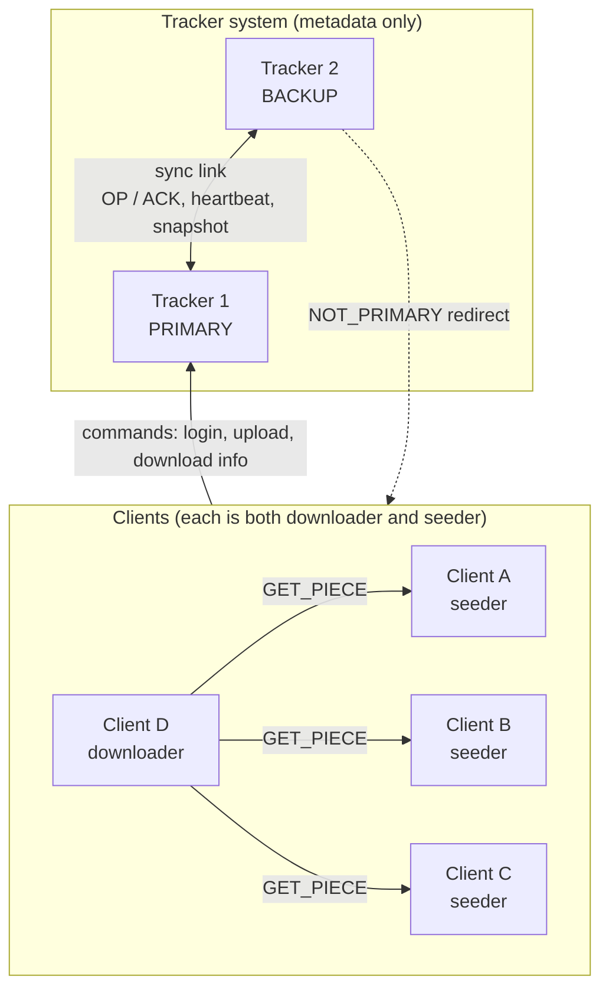
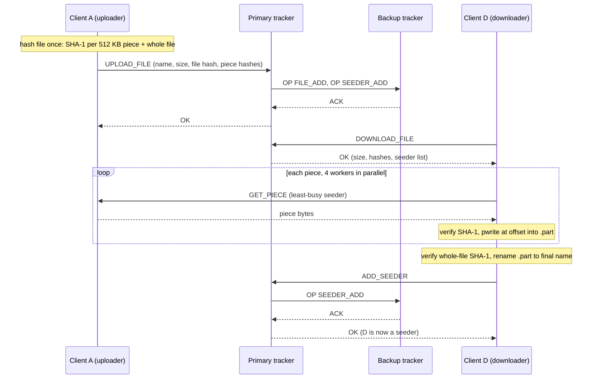
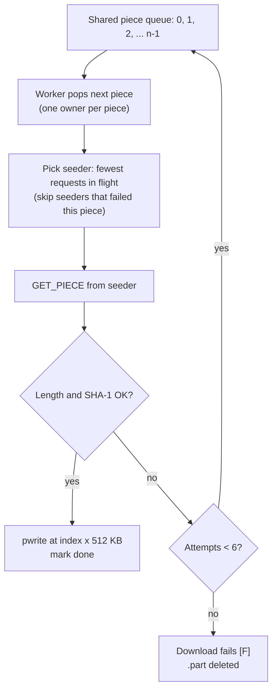
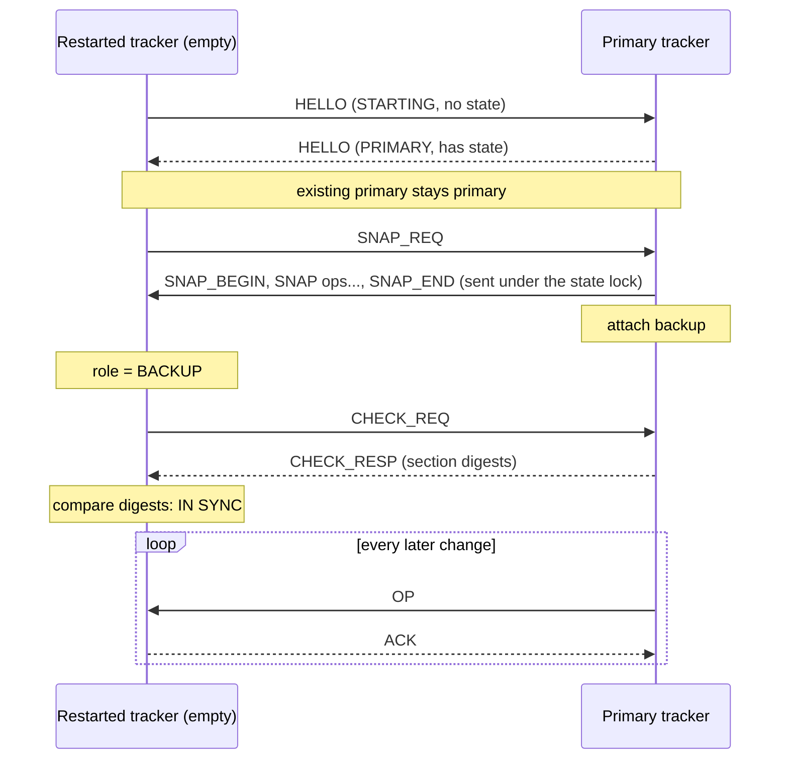
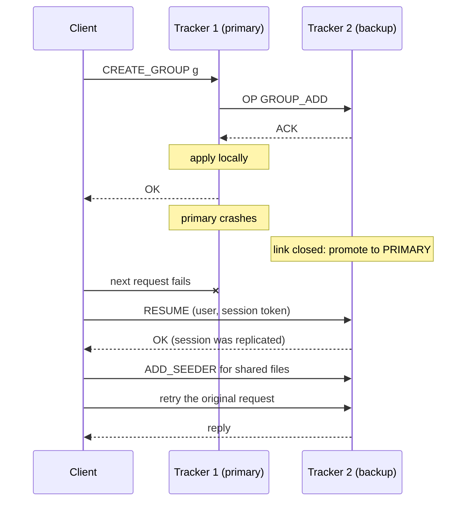
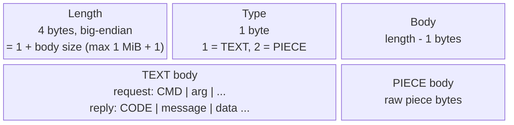

# Fault-Tolerant P2P File Sharing

A peer-to-peer file-sharing system in C++17, inspired by BitTorrent. Users log in, form groups, and share files inside those groups. File data moves directly between clients in 512 KB pieces, and every piece is verified with SHA-1. Two trackers hold only metadata, keep each other in sync by primary/backup replication, and the system keeps working as long as one of them is up.

This started as AOS Assignment 3 (IIIT Hyderabad, Monsoon 2025) and was rebuilt to focus on correctness, fault tolerance and authentication.



| | |
|---|---|
| Code | ~2,900 lines of C++ (`common/` 733, `tracker/` 1,167, `client/` 985) |
| Tests | 62 unit checks plus tracker, download, failover, regression and chaos suites |
| Dependencies | POSIX sockets, pthreads, OpenSSL `libcrypto` (hashing and randomness only) |

## Documents

| File | What it is |
|---|---|
| [docs/TECHNICAL_REPORT.md](docs/TECHNICAL_REPORT.md) | Design rationale, challenges and solutions |
| [docs/TEST_REPORT.md](docs/TEST_REPORT.md) | Every test suite and its results |

## Build and run

```sh
make                   # builds tracker/tracker and client/client
make test              # unit tests
make integration       # tracker, download, failover and regression suites (needs python3)
sh tests/run_all.sh     # also the 20-round chaos suite
python3 tests/test_big.py  # optional 2.5 GiB transfer and peak-memory check
```

**Linux:** you need `g++` and `libssl-dev`.
**macOS:** run `brew install openssl@3` first. The Makefiles detect macOS and use Homebrew's OpenSSL.

```sh
./tracker/tracker tracker_info.txt 1                 # tracker 1
./tracker/tracker tracker_info.txt 2                 # tracker 2
./client/client 127.0.0.1:7001 tracker_info.txt      # a client
```

- `tracker_info.txt` has one line per tracker, in the form `ip:client_port:sync_port`.
- The client's argument is **its own listen address**: other peers connect there to fetch pieces.

**Client commands:**
`create_user`, `login`, `logout`, `create_group`, `join_group`, `leave_group`, `list_groups`, `list_requests`, `accept_request`, `upload_file <group> <path>`, `list_files`, `download_file <group> <file> <dest>`, `show_downloads`, `stop_share`, `quit`.

**Tracker console:** `quit`, `check_sync`, `state`, `users`.


## Architecture

| Component | What it does |
|---|---|
| **Tracker** (×2) | Stores users (salted SHA-256 password hashes), sessions (hashed tokens), groups, members, join requests, file metadata (size, whole-file SHA-1, per-piece SHA-1) and seeders. It never sees file contents. |
| **Client** | Runs a command line and a **peer server** (1 acceptor plus 8 upload threads) that serves pieces of shared files. Each running download uses **4 workers**, with **at most 3 downloads at once**; extra requests queue as `[Q]`. |

There are three kinds of connection, all TCP, all using the same frame format:

1. client ↔ tracker: commands
2. client ↔ client: `GET_PIECE` requests and piece data
3. tracker ↔ tracker: replication (`OP`/`ACK`), heartbeats, snapshots

### Code layout

| File | Responsibility |
|---|---|
| `common/net.*` | Length-prefixed frames, exact send/receive, sockets, `accept_until` |
| `common/util.*` | Input validation, safe number parsing, piece arithmetic |
| `common/crypto.*` | SHA-1/SHA-256 (incremental for big files), CSPRNG, salted password hash, constant-time compare |
| `common/config.h` | Every fixed parameter, each with the reason for its value |
| `tracker/state.*` | All tracker data, plus `apply(op)`: the only code that changes it |
| `tracker/tracker.*` | Request handlers: validate, check identity and permissions, build op, commit |
| `tracker/replication.*` | Tracker↔tracker link: roles, synchronous replication, heartbeats, snapshots, `check_sync` |
| `tracker/main.cpp` | Listener, per-connection threads, console |
| `client/tracker_client.*` | Requests to the tracker, with failover and token-based session resume |
| `client/downloader.*` | Download slots, piece scheduler, verification, `.part` file and rename |
| `client/peer_server.*` | Serves pieces with `pread` at 64-bit offsets |
| `client/main.cpp` | Command line, one-pass file hashing |

## Key algorithms

### 1. Integrity
1. Uploading reads the file once, computing SHA-1 for every 512 KB piece and for the whole file.
2. Every received piece is checked (length and SHA-1) **before** it is written.
3. Pieces are written with `pwrite` at offset `index × 512 KB` into `<dest>.part`, opened with `O_NOFOLLOW`.
4. After the last piece, the whole file's SHA-1 is checked, and only then is the file renamed to its final name.

A corrupt or partial file therefore never appears under the real name, and a downloader becomes a seeder only after full verification.



### 2. Piece selection: work queue plus least-connections
All piece indexes go into a shared queue. Each worker pops the next one, so a piece has exactly one owner and nothing is downloaded twice. The worker sends its request to the seeder with the **fewest requests in flight**, the standard *least-connections* load-balancing rule; ties go to the seeder that has served the fewest pieces. A seeder that failed a piece is skipped for that piece, and the piece goes back on the queue, up to 6 attempts in total.

Rarest-first is pointless here because every seeder holds the whole file (uploaders and fully verified downloaders only). Least-connections also adapts automatically: a slow seeder holds its requests longer, so it gets picked less often. With 3 seeders, 200 pieces split 73/64/63.



### 3. Tracker replication: primary/backup
- **Everything is an op.** Every state change is a text op (e.g. `MEMBER_ADD|team|bob`), and `State::apply(op)` is deterministic. Random values (salts, tokens) are generated *before* the op is built, so the op carries them and the backup never generates its own.
- **Synchronous replication.** The primary sends each op to the backup, waits for its `ACK`, applies it locally, and only then replies to the client. While the backup is attached and acknowledges, a successful change exists on both trackers. If replication fails, the primary continues alone; subsequent failure of that primary can lose changes that were not replicated.
- **Roles are decided by a HELLO exchange,** with the same rule on both sides. If exactly one tracker is primary, it stays primary. If both are starting, tracker 1 becomes primary. If both are primary (after a split), a tracker with empty state never wins; otherwise tracker 1 wins.
- **Failure detection.** A closed link, or 6 s without a heartbeat (sent every 2 s), means the partner is down. When that happens, the backup promotes itself.
- **Recovery is always "restart from scratch".** The recovering tracker starts empty, sends `SNAP_REQ`, and receives every op that rebuilds the state. The primary holds its lock while sending the snapshot, so no change can slip in between. The recovered tracker then verifies itself with `check_sync`. The loser of a split-brain uses exactly the same procedure.
- **`check_sync`** compares a SHA-256 digest of each section (users, sessions, groups, members, requests, files, seeders) and names any section that differs.



### 4. Client failover
`TrackerClient::request()` handles failover itself, so the rest of the client never sees it:
- On a `NOT_PRIMARY` reply, it follows the address given in the reply.
- On a broken connection, or no reply within 10 s (a frozen tracker), it moves to the other tracker. A tracker that just failed is tried last.
- On the new tracker it sends `RESUME` with its session token, never the password, re-announces its shared files, and retries the request once.



## Network protocol

Every message is one frame:



| Field | Size | Meaning |
|---|---|---|
| length | 4 bytes, big-endian | 1 + body size. Rejected if over 1 MiB + 1, before anything is allocated. |
| type | 1 byte | `1` = TEXT, `2` = PIECE |
| body | length − 1 bytes | TEXT: a request `CMD\|arg\|...` or a reply `CODE\|message\|data...`. PIECE: raw piece bytes. |

A TEXT body is a request (`CMD|arg|arg`) or a reply (`CODE|message|data...`); a PIECE body is raw bytes. Frames are needed because TCP is a byte stream with no message boundaries: one `recv` can return part of a message, or two messages at once.

**Reply codes:**

| Code | Meaning |
|---|---|
| `OK` | Success |
| `AUTH_FAILED` | Unknown user or wrong password. Deliberately one reply for both, so usernames can't be probed. |
| `NOT_LOGGED_IN` | The command needs a session |
| `INVALID_ACTION` | Not a member or owner, or malformed input |
| `NOT_FOUND` | No such group, file or request, or no online seeder |
| `ALREADY_EXISTS` | Duplicate user, group or request, or the same file name with different content |
| `NOT_PRIMARY` | This tracker is the backup; the data field holds the primary's address |

**Client → tracker commands:**
`CREATE_USER|u|pw`, `LOGIN|u|pw|listen_addr` (reply carries the token), `RESUME|u|token|addr`, `LOGOUT`, `CREATE_GROUP|g`, `JOIN_GROUP|g`, `LEAVE_GROUP|g`, `LIST_GROUPS`, `LIST_REQUESTS|g`, `ACCEPT_REQUEST|g|u`, `UPLOAD_FILE|g|name|size|sha1|h1,h2,...`, `LIST_FILES|g`, `DOWNLOAD_FILE|g|name` (reply: `size|sha1|hashes|user@ip:port,...`), `STOP_SHARE|g|name`, `ADD_SEEDER|g|name`.

**Peer ↔ peer:** `GET_PIECE|g|name|index` gets back either a PIECE frame or an error TEXT frame.

**Tracker ↔ tracker:** `HELLO|id|role|has_state`, `OP|<op>` / `ACK`, `HB`, `SNAP_REQ` / `SNAP_BEGIN` / `SNAP|<op>` / `SNAP_END`, `CHECK_REQ` / `CHECK_RESP|digests|summary`.

## Data structures and why

| Structure | Why |
|---|---|
| `std::map` / `std::set` for all tracker state | Sorted iteration makes snapshots and digests canonical, identical on both trackers. O(log n) is irrelevant at this scale. |
| One mutex around the tracker `State` | Every request is a few map operations. One lock makes "check, then change" atomic, so two clients can't create the same group at once. It also keeps replication ordered. The cost is that requests are serialized. |
| `std::deque` piece queue, plus per-seeder in-flight and served counters | O(1) pop and re-queue, and an O(seeders) least-connections choice |
| `std::string` for piece data | Holds any bytes, including `\0`, with an explicit length, so binary files are safe |
| `std::atomic` progress counters | `show_downloads` reads progress while worker threads update it |

## Security model

What this system **does** provide:
- **Password storage:** salted SHA-256 (16-byte random salt per user), compared in constant time. Only hashes are stored and replicated.
- **Sessions:** 256-bit random tokens; trackers store only the token's SHA-256 hash.
- **Identity always comes from the session.** A user can only register themselves as a seeder.
- **Membership is checked** on every group operation.
- **Strict input validation:**
  - names are 1–64 characters of `[A-Za-z0-9._-]`, never `.` or `..`;
  - numbers are parsed without exceptions;
  - every range is checked.
- **No secrets in logs:** only the command name and user are logged.
- **Integrity against faulty or malicious peers:** piece and whole-file SHA-1.

Not provided (out of scope):
- No encryption (TLS).
- No authentication on the tracker↔tracker link.
- No access check at the seeder: a seeder serves anyone who knows its address and a file name.
- Socket connect, peer receive and send waits have a 5 s bound for stalled I/O; tracker replies use 10 s. These are idle timeouts, not end-to-end request deadlines.
- Fast hashing: salted SHA-256 is quick to brute-force offline compared with PBKDF2, bcrypt or Argon2.

So this is fault-tolerant P2P with authentication and integrity checks, not a "secure P2P" system.

## Assumptions

- Group names are case-insensitive.
- File names cannot contain spaces, `/` or `|`.
- The owner can never leave a group, and groups are never deleted.
- `download_file`'s destination is either an existing directory (the file is saved as `<dir>/<name>`) or a full file path.
- File permissions are not transferred, only the bytes.
- One session per user: a newer login replaces the old one.
- Disconnecting stops sharing but keeps the session, so the client can resume it after a failover.
- Logout cancels outstanding downloads and clears local shares. Log in and upload files again to resume sharing.

## Limitations

- **Split-brain data loss.** With only two trackers, a split can't be told apart from a crash. After a split, the loser's changes are discarded. Avoiding that needs a third node to break the tie (a quorum).
- **No persistence.** If both trackers are down at the same time, all metadata is lost.
- **Network partitions:** each side may accept writes independently; reconnection discards the losing tracker's changes. Strict consistency and continued writes on both isolated nodes are not both provided.
- **Resource exhaustion:** tracker connections and peer connection queues are not capped; allocation/thread creation failures are not comprehensively handled.
- **Sessions do not expire.**

## Testing

| Suite | Checks | What it proves |
|---|---|---|
| `make test` | 62 | Framing (split, merged, binary and oversized frames), validation, piece math, hash test vectors |
| `tests/test_download.py` | 74 here; 99 with ffmpeg | 17 file types and sizes downloaded byte-exact, 3-seeder spread, `[Q]` queue, corrupt seeder, seeder killed mid-download, non-member refused |
| `tests/test_failover.py` | 28 | Redirect; primary killed mid-download; recovery; roles swapping back and forth; freeze (split) and heal |

The seven executed suites passed 289 checks, including 300 malformed tracker messages, 20 chaos rounds and a 2.5 GiB transfer. Valgrind and ThreadSanitizer were not run in this review. See [docs/TEST_REPORT.md](docs/TEST_REPORT.md) for measured results and reproduction commands.

The [technical report](docs/TECHNICAL_REPORT.md) covers the design decisions and the problems solved.

ffmpeg enables generated video/audio/image fixtures; those cases are skipped when it is absent. Python scripts are test tooling; the system implementation is C++17. OpenSSL is used for cryptographic primitives and must be permitted by the assignment evaluator's interpretation of “standard system calls and libraries.”
